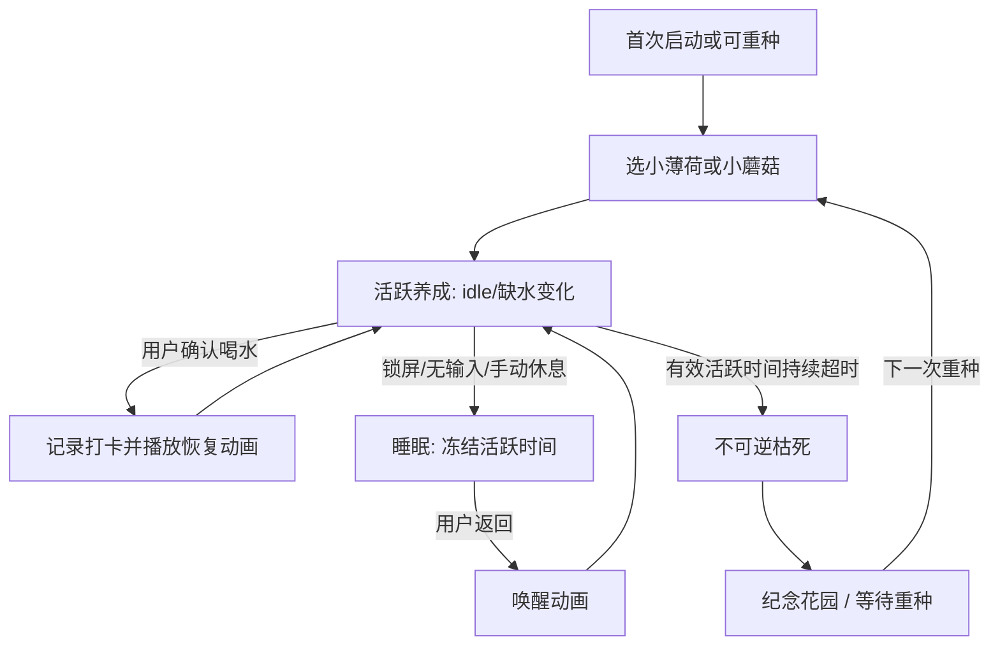

# 01｜PRD：产品与交互需求

## 用户故事（以可测试行为表达）

- **首次启动：**进入欢迎引导 → 首次获得一张免费选种券，可从小薄荷、小蘑菇中任选其一（未选的品种暂定之后用 6 水滴币解锁）→ 小植物在任务栏上方出现 → 一句话说明「喝完水点我一下」。无需账号。
- **正常工作：**植物轻轻摇摆而不抢注意力；进入缺水阶段后颜色/姿态变化，达到提醒阈值时轻气泡提示一次。
- **已喝水：**单击植物 → 本地记录一次有效确认 → 水滴落下、茎叶舒展 → 状态回归健康且提醒周期重新计时 → 可获得币/成长进度（需满足防刷条件）。
- **已经提醒但用户没喝：**继续活跃时长推进 → 严重缺水 → 濒死 → 最终不可逆枯死。出现温柔的生命纪念卡，不责备。
- **离开电脑：**锁屏、系统待机、空闲过久或主动让植物睡觉 → 进入睡眠；计时与生长冻结。回来后播放唤醒动画，从进入睡眠前的状态和剩余时间接着走。
- **死亡后：**无法给这株复活；纪念花园保存本代存活时间/已记录喝水次数。由用户自行决定是否、何时种植下一株；绝不自动种植。
- **逛商店：**通过托盘的“设置 / 种子铺”进入：查看已解锁品种、库存/水滴币与未来的隐藏款；不影响当前生命。

## 核心场景流程

## P0 功能需求与验收口径

| ID | 功能 | 验收标准 |
| --- | --- | --- |
| FR-01 | 透明浮窗 | 128px 默认展示，小/大尺寸可选；任务栏之上，非活跃不抢焦点；窗口内透明区域尽量点击穿透并做真机测试 |
| FR-02 | 两植物 | 选择后保持该代植物和个体编号，不能中途用更换皮肤绕过死亡 |
| FR-03 | 喝水确认 | 用户明确点击「我喝水了」才算有效记录；动画不替代入账回执 |
| FR-04 | 提醒 | 恰当阈值弹出一次气泡，自动消失；气泡可以禁用，右键菜单能查看剩余时间 |
| FR-05 | 状态变迁 | 时间阈值严格按 02 文档，边界秒一致；只能活跃积时触发死亡 |
| FR-06 | 睡眠唤醒 | 锁屏/休眠/手动睡眠立即保护；空闲超阈值自动保护；睡眠不成长也不恶化 |
| FR-07 | 持久化 | 进程关闭或系统重启后恢复上次生命，不把未运行时间计为活跃时间 |
| FR-08 | 种子铺 | 查看并解锁至少两植物；拥有的品种永久保留，首版币值以配置为准 |
| FR-09 | 图鉴纪念册 | 可查看品种、活跃/已死亡实例及每代统计；没有数据时有精心制作的空态 |
| FR-10 | 设置 | 提醒间隔、空闲睡眠阈值、工作时段、托盘入口、是否显示气泡可更改并生效 |
| FR-11 | 视觉表现 | 无五官；五生命周期阶段 + 睡眠/唤醒有明显不同的姿态/动效；小蘑菇/薄荷画风一致 |
| FR-12 | 自我保护 | 提供「暂停 / 今天不提醒」和误操作撤销确认，确保不是行为惩罚工具 |

## 时间和奖励的产品语义

- 默认提醒间隔：45 分钟（可配，非医疗建议）。
- 阶段百分比是**自上次有效确认后累计的活跃计时**，不是墙上时间；完整公式见 02。
- 用户“点过”不代表摄入毫升数，不显示/暗示准确饮水量；提醒可以调整或暂停。
- 有效奖励可用例子：同一个周期内首次确认奖励一次，后续快速连点不重复奖励；防刷规则写在 07。
- v0.1 成长和货币以轻度激励为目的，不用惩罚使用户过度饮水或熬夜。

## 非目标与约束

- 允许用户自行忽略提醒；不要用高频提示打断工作。
- 死亡不应发生在软件退出、睡眠、锁屏、Windows 重新启动期间；故障后按保护用户原则恢复。
- 用户应可找回误点菜单的操作，但**不能用“撤销喝水”来回滚已经不可逆的死亡**。

## 尚待用户确认

重种具体时间、睡眠自动阈值、提醒节奏、默认角色选择、奖励经济、是否允许暂时切换品种等见 `10_待讨论决策与默认值.md`。
