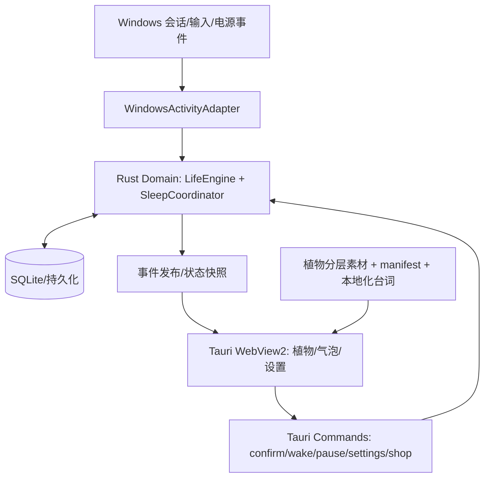

# 06｜技术架构：Tauri 2 + Rust + TypeScript（Windows 优先）

## 1. 目标架构



核心决策：**Rust 是业务状态唯一真源**，JavaScript 只渲染和触发意图；`setInterval` 或 CSS 不能负责植物生死。优先桌面离线单用户运行。

## 2. 推荐模块

```text
src-tauri/src/
  domain/            life_engine.rs, transitions.rs, economy.rs
  application/       commands.rs, event_dispatcher.rs
  platform/windows/  activity.rs, session.rs, power.rs, work_area.rs
  persistence/       db.rs, migrations/, repositories.rs
  assets/            manifest_loader.rs
src/
  windows/           PlantWindow.ts, SettingsWindow.ts, BubbleWindow.ts
  components/        PlantRenderer, PlantStatusCard, SeedShop, Collection, Memorial
  animations/        PlantRig, AnimationOrchestrator, Fx
  state/             read-only state snapshot projection
  styles/            theme tokens, shared bubble/card/panel
  locales/           zh-CN, future i18n
assets/species/       mint/, mushroom/
tests/                 unit/, integration/, e2e/, visual/
```

## 3. Rust 对外命令合同（建议命名）

| Command | 目的 | 结果 |
| --- | --- | --- |
| `get_app_snapshot()` | 全量业务只读状态 | instance + effective_timer + sleep + inventory + settings |
| `confirm_drink(request_id)` | 用户明确确认喝水 | `accepted/duplicate/rejected` + 最新 snapshot |
| `request_sleep(mode, duration?)` | 手动让植物睡觉 | 状态与失效时间 |
| `request_wake()` | 手动移除 MANUAL 理由 | 如仍锁屏，依旧 SLEEPING |
| `update_settings(patch)` | 校验后更新设置 | 归一化设置和生效周期 |
| `purchase_seed(species_id, request_id)` | 解锁/购买品种 | 事务结果、余额、库存 |
| `plant_seed(species_id, request_id)` | 创建新一代 | 新 instance_id；死亡旧实例保持不可变 |
| `list_memorials(page)` | 历史生命记录 | 分页列表 |

事件仅作为提示；任何前端收到事件后需要能再次 `get_app_snapshot` 恢复一致状态，不能靠丢包不可靠的增量状态作唯一依据。

## 4. Windows 平台能力（实现路径，需按实际 Tauri 版本验证）

- 检测输入空闲：Win32 `GetLastInputInfo`，按当前会话适用；不要监控用户具体键盘内容。官方文档：<https://learn.microsoft.com/en-us/windows/win32/api/winuser/nf-winuser-getlastinputinfo>。
- 锁屏/解锁：窗口注册会话通知 `WTSRegisterSessionNotification`，处理 `WM_WTSSESSION_CHANGE`（LOCK/UNLOCK）。官方文档：<https://learn.microsoft.com/en-us/windows/win32/api/wtsapi32/nf-wtsapi32-wtsregistersessionnotification>。
- 挂起/恢复：处理 `WM_POWERBROADCAST` 与相关 PBT 事件。官方文档：<https://learn.microsoft.com/en-us/windows/win32/power/wm-powerbroadcast>。
- 窗口透明、无边框、skip taskbar、位置和置顶均以所安装的 Tauri 2 API 为准。窗口透明不保证原生点击穿透，需要命中测试。
- 持久化可用 SQLite（推荐放业务流水和活跃生命）+ JSON 配置；如使用 Tauri Store，要验证写入时机和崩溃恢复。文档：<https://v2.tauri.app/plugin/store/>。
- 全局快捷键不是 P0 必选；如未来使用，按 <https://v2.tauri.app/plugin/global-shortcut/> 当前版本接入，注意权限及按键冲突。

## 5. 计时与状态流

1. `LifeEngine` 接收模拟/真实活动片段，而不是直接访问系统时钟；可无 GUI 单元测试。
2. `WindowsActivityAdapter` 周期性收集会话 idle 和系统事件，维护**已确认活动时长**与暂定 idle 窗口（见 02）。
3. `LifeEngine.reduce(event)` 产生新状态、可持久化事件和动画通知。提交数据库后才能对 UI 广播“喝水成功 / 死亡 / 购买成功”。
4. 对设置修改使用带版本号的配置快照，不允许改了提醒间隔直接使一株健康植物死亡。
5. 生命周期资源按实例/周期记录，防止重复 Tauri command 或重启后误重复奖励。

## 6. UI 的窗口约束

- 每个窗口使用稳定 label：`plant`、`bubble`、`settings`；只允许一个业务后端实例，隐藏窗口不等于退出。
- 透明空白区域的点击穿透只在平台行为已确认后开启，不得使植物本体不可点击。
- 以 work area 定位，不使用绝对屏幕假设；保存显示器标识和相对偏移，显示器移除时回退主屏。
- 气泡窗可用同一植物窗 DOM 内定位；若要越过窗边界，再采用独立透明窗；优先简单可靠。
- 降低高频重绘，睡眠态下降低动画帧率；可关闭动画而保持计时准确。

## 7. 安全与隐私

- 不请求管理员权限，不扫描文档，不读取应用中的个人信息。
- 输入空闲检测只获得最后输入时间，不记录按键内容，不做行为分析上传。
- 数据只保存在本机用户目录；允许“备份 / 导出 / 清空”，清空必须二次确认。
- 资源载入必须校验相对路径和 manifest schema，避免错误资源导致静默崩溃。

## 8. 实现阶段的验证点

- 在真实 Windows 10/11 中验证锁屏、会话切换、系统睡眠、桌面重启和自启动行为。
- 证实 Tauri 2 窗口设置 API 与当前构建版本兼容，不能从网上示例直接复制已过时的 API。
- 提供无系统依赖的模拟 Windows 事件测试适配器 `FakeActivityAdapter`。
- 测量内存、CPU、冷启动与 WebView2 基础占用，标注环境与采样方式。
